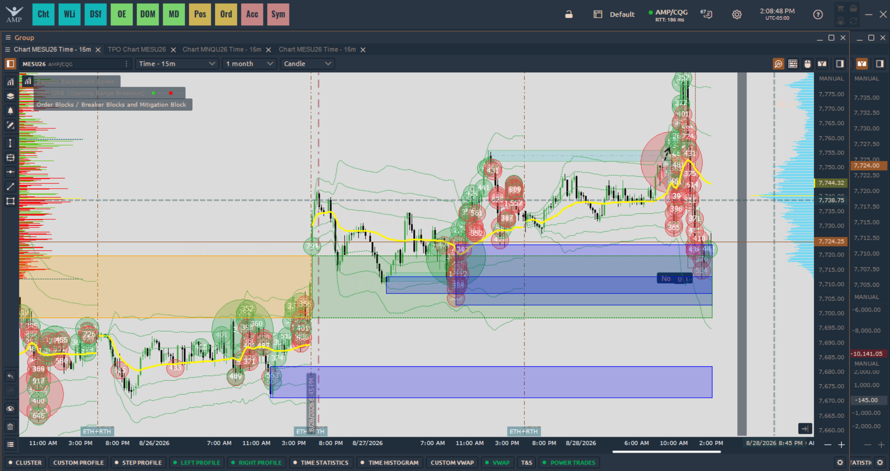

# 15m Opening Range Breakout (ORB) Strategy for AMP Quantower

This repository contains a professional-grade 15-Minute Opening Range Breakout (ORB) indicator built natively for the AMP Quantower trading platform. It automatically maps the high and low of the first 15 minutes of the New York trading session (09:30 AM to 09:45 AM EST) and draws precise, static levels across your chart to use as a breakout trading framework.

## Features

- **Automated Levels:** Automatically captures the true high and low of the 09:30-09:45 EST window without requiring manual drawing.
- **Timezone Reliability:** Uses native Eastern Standard Time (EST/EDT) conversion from UTC. This ensures the 09:30 AM open is always accurately detected regardless of your computer's local timezone.
- **Infinite Drawing:** The ORB lines stay perfectly horizontal across your entire trading day, anchoring your price action to the most critical liquidity levels of the session.

## Preview

## Installation

1. Download the `15m_ORB_Strategy.cs` file from this repository.
2. Open your AMP Quantower platform.
3. Open the **Algo** window and click **Create New Indicator**.
4. Paste the code into the editor.
5. Click **Compile** to build the indicator.
6. Right-click your chart, go to Indicators, and add the ORB strategy!

## Customization

You can easily adjust the colors, line width, and line styles (solid, dashed, dotted) of the ORB High and ORB Low directly within the Quantower indicator settings menu without modifying the C# code.
